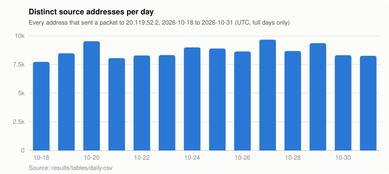
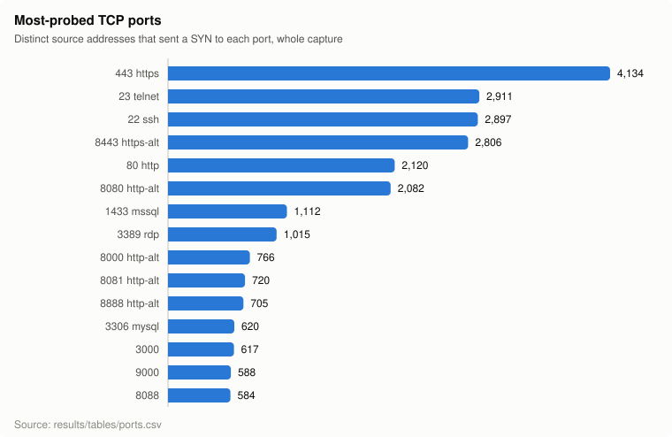
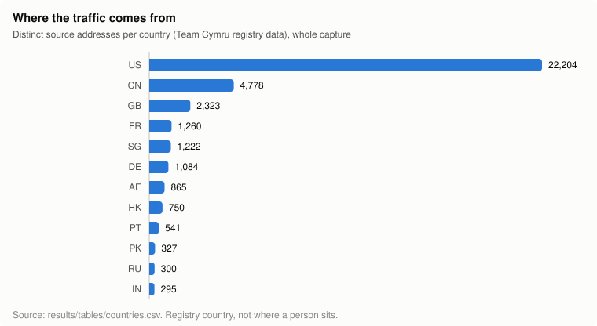

# whoHit

Who still knocks on an IP address after you stop using it?

For 15 days (17 Oct to 1 Nov 2026) an Azure VM at `20.119.52.2` answered on **every TCP
port** and logged everything that reached it: every SYN, UDP packet and ping, plus what
each client said once connected (HTTP requests, TLS ClientHellos, SMTP envelopes, the
first bytes of everything else). Six lapsed lookalike domains, with wildcard DNS, point
at the box: `googledrive.download`, `sharepoint.download`, `onedrive.download`,
`outlook.download`, `drive.download` and `msft.download`. The question was whether
anything real still depends on them before they are let go.

**Short answer: nothing depends on them.** Almost everything is scanners. The rest is
a handful of people who typed a search into the address bar and some security
vendors keeping an eye on the names.

This repo has the write-up (below), the [aggregate tables](results/tables), a
[sanitised copy of the raw logs](data) and [the code](whohit) that collected them.

## In numbers

| | |
|---|---|
| Packets logged (TCP SYNs, UDP flows, pings) | 1,363,137 |
| Connections the listener handled | 964,872 |
| Distinct source addresses | 40,277 |
| ...labelled scanner (says so, or behaves like one) | 15,315, sending 77% of all packets |
| ...cloud / hosting networks | 15,078 |
| ...everything else (home, mobile, office) | 9,884 |
| Requests that named one of the six domains | 15,367 from 1,266 addresses |

About 7,700 to 9,700 different addresses touch the box every day, and 1,400 to 3,900
of them have never been seen before. The rate does not tail off.

Port 22 is the real SSH server (key-only); every other port was redirected to the
listener, so the [ports table](results/tables/ports.csv) also records what each client
actually spoke. Port numbers say little: 2222, usually SSH, mostly got HTTP and
TLS, and a fifth of the connections to 3389 were TLS or HTTP instead of RDP.

## The six domains

- **No mail was addressed to them.** The listener answers SMTP and refuses every
  recipient with a temporary `450`, so a real sender would have kept retrying. None did.
- **No logins or credentials were sent to them.** All 57 login-form posts the box
  received went to the bare IP address, not to any of the domains.
- **Real people, all of them typing searches into the address bar**:
  `beamng.drive.download` (Iraq, a car game), `google.drive.download` (Vietnam,
  Slovakia, three US homes), `google.com.drive.download` (France, Israel, US),
  `www.outlook.download` (UAE, Starlink, US), and one person in Brazil who tried
  `double.dragon.zeebo.mega.drive.download`. Whoever owns these names next inherits that
  traffic.
- **Security vendors watching specific hostnames.** Some hostnames under the domains
  contain organisation names; those labels are replaced with `redacted-a` to
  `redacted-n` everywhere in this repo. Ten addresses on one regional ISP have checked
  four of these hostnames twice a day since 19 Oct, 615 requests so far. That looks
  like an organisation, or its security provider, watching names that look like its own.
- **`faq.onedrive.download`** got its first request on 21 Oct, for
  `/ipfs/bafkreicyqcbhpicbos7ev4mrxofwqx6hvvge7pahpta6xuspr44crai5by`, and URL
  scanners (40 addresses in China, 39 in the US) have fetched it 4,465 times since.
  The name probably sits in a link somewhere.
- Everything else under the domains is crawlers (`www.`, `m.`, `hostmaster.`),
  wordlist scanners (`dev.`, `staging.`, `doh.`, `adguard.`) and link checkers.

Per-hostname counts are in [watched_hostnames.csv](results/tables/watched_hostnames.csv).

## Things worth a look

The [techniques table](results/tables/techniques.csv) counts 36 signatures across the
whole capture. Highlights:

**What the scanners hunt for now**

| Technique | Addresses | Requests |
|---|---:|---:|
| ALPN sweeps: a TLS hello offering 5 to 50 protocols, to see which one the server picks | 3,652 | 86,993 |
| `MGLNDD_<ip>_<port>` banner sent to every port, all from Microsoft's network | 1,757 | 4,384 |
| **MCP servers** (Model Context Protocol, for AI tools) at `/mcp` and `/sse` | 1,620 | 22,552 |
| X11 on 6000-6002 | 1,148 | 1,436 |
| Industrial control: Modbus, S7, EtherNet/IP, BACnet, DNP3 | 98-129 each | |
| `.env` secrets files | 119 | 124,921 |
| VxWorks WDB debug agent (udp/17185) | 96 | 106 |
| RedTail cryptominer spreader (`libredtail-http`) | 76 | 1,559 |
| SGLang `/update_weights_from_*`, which loads new weights into a running LLM server | 58 | 99 |
| Exposed `.git/config` | 50 | 2,093 |
| Ollama and OpenAI-compatible LLM APIs | 40 | 130 |
| SAP NetWeaver CVE-2025-31324 (`/developmentserver/metadatauploader`) | 30 | 30 |
| React Server Actions (`Next-Action` header), the React2Shell shape | 29 | 574 |
| Next.js middleware bypass CVE-2025-29927 (`x-middleware-subrequest`) | 8 | 4,301 |

**The fun ones**

- A botnet dropper whose user agent is **`KrebsOnSecurity`**. It sends the classic
  JAWS DVR `/shell?cd+/tmp;wget+...` download-and-run.
- Censys's BitTorrent DHT probe uses the node ID **`censysinspectscanner`** (exactly
  20 bytes).
- A 50-protocol ALPN list, sent 2,295 times from 45 addresses (mostly Modat's
  scanners), offers **`postresql`**, misspelled.
- A secrets scanner requested **`/$(pwd)/.env.production`**: the wordlist never ran
  the shell command.
- A Next.js exploit tool sends **`x-nextjs-request-id: poop1234`** (105 times).
- Google Cloud addresses requested `/z9x8c7v6b5-debug-trigger-<hostname>`, each time
  wearing a different AI crawler's user agent: GPTBot, PerplexityBot, Kimi, Qwen,
  cohere-ai, ChatGLM, Brave, You.com.
- Two addresses on one Romanian-registered network sent **114,690** `.env` requests
  between them.
- Palo Alto's Xpanse scanner introduced itself ("Hello from Palo Alto Networks")
  69,085 times from 2,059 addresses.
- `Hello, World` as a user agent, sent with a UPnP `AddPortMapping` request asking a
  home router to open a port.

**The email.** No message was ever delivered, because the box never accepts mail data.
It did collect 36 envelopes, every one a spammer testing whether the box would relay
for them ([data/smtp.csv](data/smtp.csv)):
- `dpr@priv8shop.com` tried Yahoo, Hotmail and Gmail addresses, cycling through ports
  25, 587 and 2525 after each refusal.
- `spameri@tiscali.it` mails itself, from Windows hosts never renamed from
  `WIN-CLJ1B0GQ6JP`.
- One relay test spoofed random senders at our own domains (`HELO smtp.outlook.download`).
- One host sent `HELO test.com`, then tried `root@`, `postmaster@` and `nobody@localhost`
  as senders within two seconds.

## The data

See [data/README.md](data/README.md) for columns and exactly what was removed.

- [`data/attempts.csv.gz`](data/attempts.csv.gz): every packet-level hit, 1.36M rows
- [`data/sessions.csv.gz`](data/sessions.csv.gz): every connection the listener handled, with HTTP and TLS details, 965k rows
- [`data/sources.csv.gz`](data/sources.csv.gz): every source address with its network, country and label
- [`data/smtp.csv`](data/smtp.csv): SMTP envelopes
- [`results/tables/`](results/tables): ports, protocols, countries, networks, paths,
  user agents, hostnames, techniques and daily totals

Privacy, briefly:
- Addresses labelled scanner or cloud stay as they are.
- Home, mobile and office addresses are pseudonymised (`anon-…`), wherever they appear.
- Email local parts are masked.
- Hostname labels that name organisations are redacted.
- Credentials and form values were never stored.

## How it works

Four small Python services (standard library only) on Ubuntu 24.04:
- `sniffer.py` logs every inbound packet from a raw socket.
- nftables redirects every TCP port except 22 to `listener.py`. The listener speaks
  enough HTTP, TLS, SMTP and banner protocols to get clients to say what they want,
  and recovers the original port with `SO_ORIGINAL_DST`.
- `enrich.py` labels each source by network, reverse DNS and behaviour.
- `dashboard.py` serves a loopback-only dashboard.

[docs/operating.md](docs/operating.md) covers deploying and running it.
`python3 tools/publish.py <copy of whohit.db>` rebuilds `data/` and `results/`.

The labels are heuristics. "Home, mobile and office" also catches small hosting
companies and infected home routers, and a scanner on a residential line is only
labelled one if it behaves like one.
